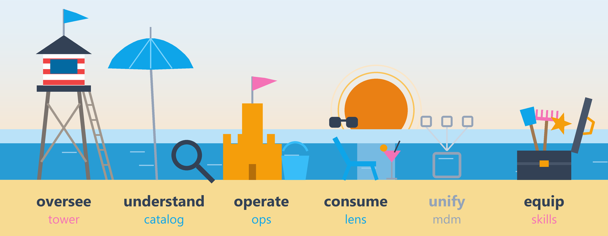

<!-- GENERATED by ade-site tools/profile_readme.py from content/family.json — do not edit here: change the source and rerun. -->

**Roberto Butinar** · data architect. I run AI agents on real data platforms, and in my own time I build ADE.

ADE — Agentic Data Engineering — is a family of open-source tools for the data estate. Understand what exists, operate it in plain language, and give people the certified answers they need, with AI agents working under rules you set. Use one, or all of them. The public cores are open source under Apache-2.0.

| Member | Does | [Status](https://ade-family.com/about) | |
|---|---|---|---|
| [**ade-catalog**](https://ade-family.com/catalog) | understand | live | [app](https://ade-catalog.vercel.app) · [code](https://github.com/rbutinar/ade-catalog) |
| [**ade-ops**](https://ade-family.com/ops) | operate | live | [app](https://ade-ops.vercel.app) · [code](https://github.com/rbutinar/ade-ops) |
| [**ade-lens**](https://ade-family.com/lens) | consume | live | [app](https://ade-lens.vercel.app) · [code](https://github.com/rbutinar/ade-lens) |
| [**ade-skills**](https://ade-family.com/#ade-skills) | equip | lab | no public link yet |
| [**ade-tower**](https://ade-family.com/tower) | oversee | lab | no public link yet |
| [**ade-mdm**](https://ade-family.com/#ade-mdm) | unify | experimental | no public link yet |

**[ade-family.com](https://ade-family.com)** · [Agent diary](https://ade-family.com/agent-diary): what the family's agents learn while they work · [LinkedIn](https://www.linkedin.com/in/rbutinar)
